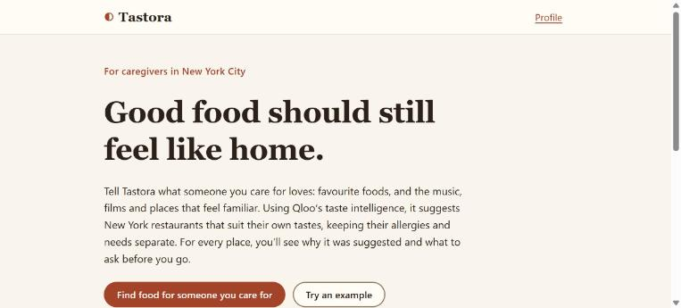
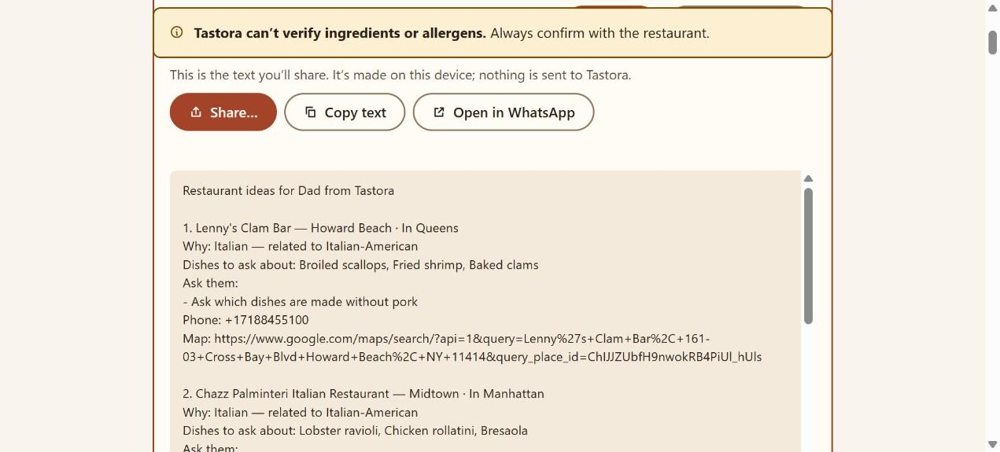
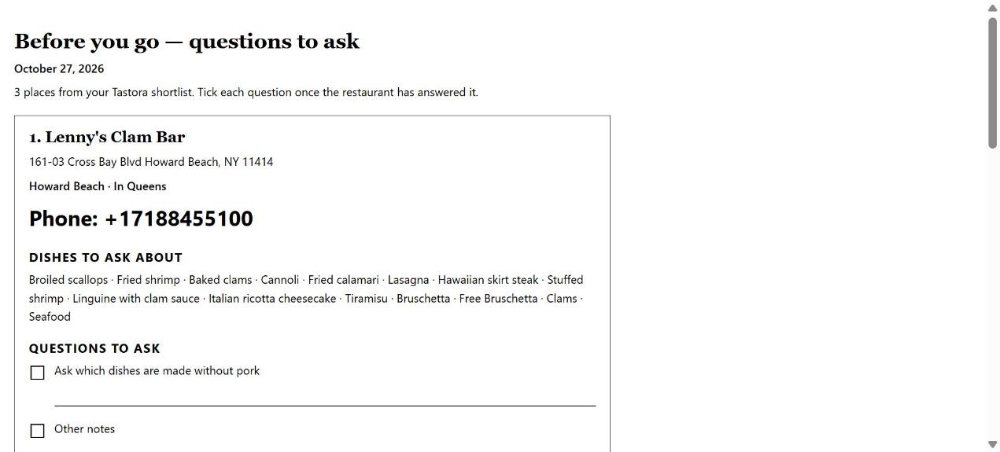
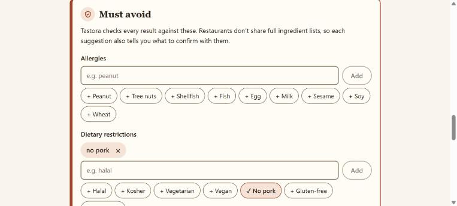
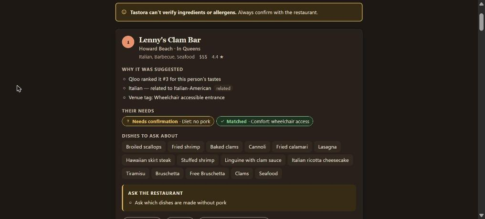
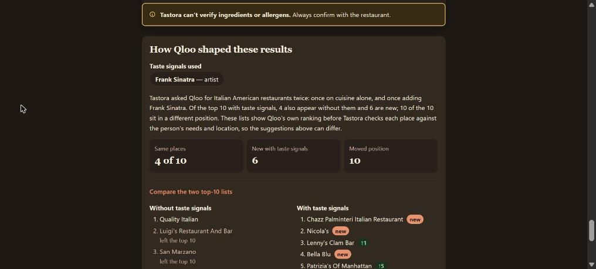
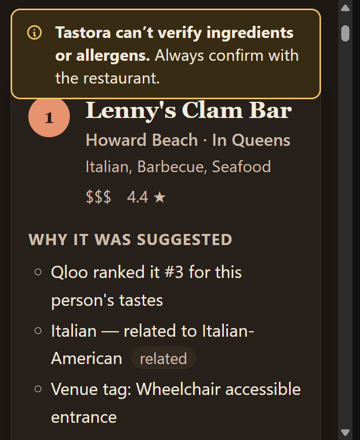
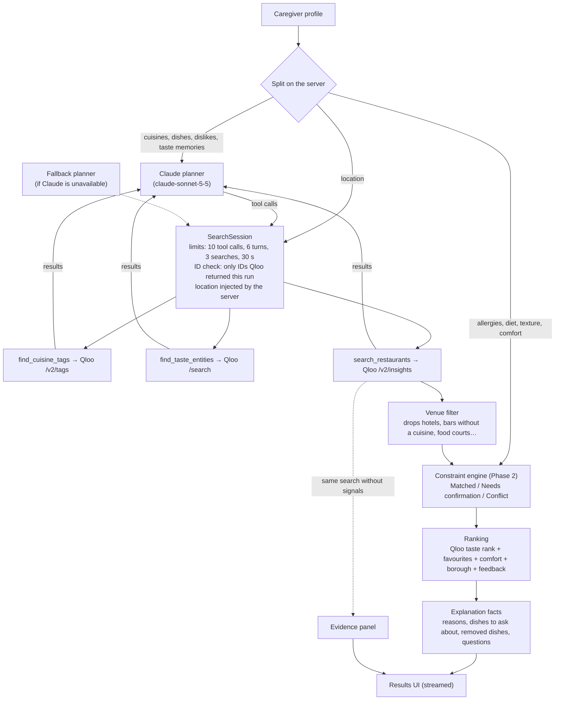

# Tastora

> Good food should still feel like home.

Tastora helps caregivers in New York City find restaurants that an older person they care for will
actually enjoy. You describe the person's own tastes: favourite cuisines and dishes, plus the music,
films and places that feel familiar to them. You also list what they must avoid. A Claude agent
plans searches against **Qloo's taste intelligence**, and Tastora's own tested code checks every
result against the person's needs. Each suggestion says why it was picked and what to confirm with
the restaurant. Tastora never presents an allergy as safe. Built for the Qloo Agentic Hackathon
2026.

**Live demo: <https://tastora-three.vercel.app>**

**Try it in 30 seconds:** open the site → **Try an example** → **Italian-American in Queens** (the
Frank Sinatra profile) → **Find restaurants**. Results stream in within a few seconds. Scroll to
**How Qloo shaped these results** to compare Qloo's ranking with and without the person's taste
signals.



## The problem

Choosing a restaurant for someone else is hard when what matters is their taste, not yours. A
caregiver might know that their dad grew up on red-sauce Italian and Sinatra, or that their mum
misses home cooking from Lagos. General search tools rank places by popularity and distance, not by
the person. Allergies and dietary needs are a second problem. Restaurant listings rarely include
ingredient or allergen information, so a tool that sounds confident about safety is guessing.

Tastora starts from the person's own tastes, with no age field and no assumptions about what older
people eat. It keeps preferences ("what they love") separate from hard constraints ("what they
must avoid"), and it is explicit about what it cannot verify.

## What Tastora does

1. **Profile.** Enter favourite cuisines and a borough (the only required fields). You can also
   add favourite dishes, dislikes, taste memories (music, films, places), allergies, dietary
   restrictions, texture needs and comfort needs (quiet, wheelchair access). Two example profiles
   are available.
2. **Search.** The search runs live: each real step (Claude's tool calls, Qloo lookups, ranking) is
   streamed to the screen as it happens.
3. **Results.** You get up to 8 restaurants. Each card shows why it was suggested, a status for
   each of the person's needs, dishes to ask about, questions to ask the restaurant, and website,
   phone and Maps links. "Show details" lists dishes set aside for the person's needs (with the
   reason) and the score breakdown.
4. **Evidence.** The "How Qloo shaped these results" panel compares Qloo's top 10 with and without
   the person's taste signals.
5. **Feedback.** Mark places Like, Not for them, Not suitable or Already tried, then search
   again. The ranking takes the feedback into account, and "Not suitable" places are not shown
   again.
6. **Share and print.** See below.

### Share and print

Caregivers rarely decide alone, and the restaurant still has to be asked about allergies and
texture. The top 3 places start on a shortlist; "Add to shortlist" on any card changes it.

- **Share** builds plain text on the device (no emoji, about 1,500 characters for 3 places): for
  each place its area, one reason, up to 3 dishes to ask about, up to 3 questions to ask, phone and
  a Google Maps link, then "Tastora can't confirm ingredients or allergens. Please check with the
  restaurant." Send it with the phone's share sheet, copy it, or open it in WhatsApp
  (`https://wa.me/?text=…`). Scores and set-aside dishes are never included.
- **Print checklist** (`/results/print`) is a "Before you go — questions to ask" sheet: address,
  phone in large type, dishes to ask about, warnings, and every question with a ☐ box and a line
  for notes. "Print or save as PDF"; paper is always black on white, one place per block.

| Shortlist and share text | Print checklist (print styles) |
|---|---|
|  |  |

| Must-avoid section (light) | Result card (dark) |
|---|---|
|  |  |

| Evidence panel | Mobile (375 px) |
|---|---|
|  |  |

More screenshots: [`docs/screenshots/`](docs/screenshots/) (welcome and profile in light and dark;
the notice shown when the built-in planner stands in for Claude).

## How Qloo powers it

Qloo is the restaurant source and the taste engine. Tastora uses three Qloo endpoints. Details are
in [`docs/agent.md`](docs/agent.md) and [`docs/qloo-findings.md`](docs/qloo-findings.md).

| Purpose | Qloo call |
|---|---|
| Turn "Nigerian" or "Italian-American" into cuisine tags | `GET /v2/tags` (`filter.query`). Tastora keeps `urn:tag:cuisine:qloo:*` and `urn:tag:genre:place:restaurant:*` tags |
| Turn taste memories into Qloo entities ("Frank Sinatra" → artist) | `GET /search` (`query`). Artists, films, TV shows, books and places |
| Find and rank restaurants | `GET /v2/insights` with `filter.type=urn:entity:place`, `filter.location.query` (the borough), `filter.tags` (cuisine) and `signal.interests.entities` / `signal.interests.tags` (the taste signals) |

**Cross-domain taste memories.** A favourite singer or film becomes a Qloo entity, and Qloo
re-ranks restaurants by affinity with it. Tastora's Phase 1 tests found that the effect is real and
fits the culture involved. Within Italian restaurants, a Frank Sinatra signal brought up classic
red-sauce places (Chazz Palminteri, Original Vincent's) in place of Eataly and Marea. A Bob Marley
signal moved a general restaurant search toward Caribbean places. With no signals, the baseline
ranking is fully deterministic, so the differences are not noise.

**Evidence panel.** For every search, Tastora runs the main Qloo query again without taste
signals and shows both top-10 lists. It reports how many places appear in both, how many are new
and how many moved. Results from live runs
([`docs/phase5-profile-matrix.md`](docs/phase5-profile-matrix.md),
[`docs/phase3-smoke.md`](docs/phase3-smoke.md)):

| Profile | Taste signal | Same places in top 10 | Moved |
|---|---|---|---|
| Italian-American, Queens | Frank Sinatra | 4 of 10 | 10 |
| Caribbean, Bronx | Bob Marley | 0 of 10 | 10 |
| Jewish deli, Manhattan | Barbra Streisand | 6 of 10 | 9 |
| Indian, Jackson Heights | Lata Mangeshkar | 5 of 10 | 10 |
| Nigerian, Brooklyn | Fela Kuti | 10 of 10 | 7 |

The strength of the signal varies. Bob Marley replaced the whole Caribbean top 10, while Fela Kuti
only re-ordered NYC's roughly 10 Nigerian places. Where Qloo finds no entity for a memory (for
example Teresa Teng), Tastora says so under "About this search" instead of implying the memory was
used.

Qloo data is also used for venue facts: address, borough (from geocode), hours, phone, website,
Google Place ID, dish highlights, and venue tags for accessibility, noise and diet options.

## How the agent works



**The agent decides how to search. Tastora's tested code decides what is safe.**

- Claude gets three tools: `find_cuisine_tags`, `find_taste_entities` and `search_restaurants`. It
  picks the tags, resolves taste memories (in the matrix, it corrected "Nigeran" and "Fela Kutti"),
  and chooses which signals to send.
- Hard limits are enforced in code: 10 tool calls, 6 model turns, 3 restaurant searches and a
  30-second planning budget. Every ID passed to `search_restaurants` must have come from an
  earlier tool result in the same run. An invented ID returns an error to the model, and no Qloo
  call is made. `search_restaurants` has no location field: the server injects the profile's
  location.
- Claude can't add candidates, set statuses, or write the text on a card. Candidates come only
  from Qloo search results. Statuses, exclusions, ranking and explanation facts come from
  deterministic code ([`docs/ranking-and-constraints.md`](docs/ranking-and-constraints.md)).
- **Fallback planner.** If Claude is unavailable (no key, API error, timeout, refusal, or no
  successful search), a deterministic planner runs through the same session and limits. Results
  are checked the same way, and the page says the fallback was used.
- If every search returns nothing, Tastora tries the cuisine's family once (Haitian → Caribbean)
  through the same session and tells the caregiver.

## Safety and honesty model

Qloo has no ingredient, per-dish allergen or texture data. Tastora is built around that limit
instead of hiding it.

- **Three statuses**, each shown with an icon and a text label, not colour alone: **Matched**
  (an explicit Qloo tag supports it), **Needs confirmation** (no data, or data that can't prove it)
  and **Conflict** (an explicit Qloo tag contradicts it, e.g. "Loud" for a quiet preference).
- **Allergies and texture are never "Matched".** The engine always returns Needs confirmation for
  them, and the UI maps any such match to Needs confirmation as a second guard. Diet tags (kosher,
  vegetarian…) are labelled venue-level, to confirm.
- **Dish screening.** Dishes that name an allergen are removed, with tolerance for plurals and
  synonyms (shellfish → shrimp, crab, conch…). Tastora also keeps lists of dishes commonly made
  with an allergen whose names don't say so: suya and satay for peanut; bibimbap and japchae for
  sesame; gulab jamun, korma and tiramisu for milk. These are set aside with "commonly made with
  peanut; recipe not verified".
- **Allergen-heavy penalty.** If at least half of a venue's listed dishes were removed for one
  allergen, it drops 8 points (15 if all of them were) and carries a warning. Example: Brooklyn
  Suya for a peanut allergy.
- Only two things remove a venue entirely: Qloo marks it closed, or wheelchair access is required
  and a tag explicitly contradicts it. Everything else is flagged, not hidden.
- **No ordering language.** Dishes are "dishes to ask about", never a menu.
  [`tests/ui-helpers.test.ts`](tests/ui-helpers.test.ts) scans all UI source for
  order/buy/checkout/purchase/cart. It also scans for "safe", "allergen-free" and "guaranteed",
  including in server strings that reach the screen, unless the word is negated.
- A banner that stays at the top of the results says: "Tastora can't verify ingredients or allergens. Always
  confirm with the restaurant."

## Privacy

| Where | What |
|---|---|
| **Qloo** | Cuisine and taste-memory search text (e.g. "Italian-American", "Frank Sinatra"), the Qloo tag and entity IDs chosen, and the location text (e.g. "Queens"). |
| **Anthropic (Claude)** | Only favourite cuisines, favourite dishes, dislikes and taste memories, plus the Qloo tool results (tag and entity names, top restaurant names). A test checks every request body. |
| **Never sent to Qloo or Claude** | Allergies, dietary restrictions, texture, comfort needs and the display name. The display name ("Dad") is not sent to the server at all; it only appears in share text you choose to send. |
| **On the device** | The profile and feedback in `localStorage`, and the last search and shortlist in `sessionStorage` (so reloading doesn't run a new search). Clearing the profile clears all of them. Share text and the print checklist are built in the browser. |
| **On the server** | No database and no accounts. An in-memory cache of Qloo responses (10 minutes) and in-memory rate-limit counters, per server instance. A failed search logs only the error's class name. |

API keys are read server-side only and are never sent to the browser.

## Tech stack

- **Next.js 16** (App Router, route handlers, streaming NDJSON), **React 19**, **TypeScript**
- **Qloo Insights API**: `/v2/tags`, `/search`, `/v2/insights`
- **Claude** via `@anthropic-ai/sdk` (tool use; default model `claude-sonnet-5-5`)
- **Zod** for profile, feedback and storage validation
- **Vitest** (209 tests), ESLint
- CSS modules, no UI library. WCAG contrast checked, 44 px tap targets, light and dark themes.
- Hosted on **Vercel**

## Project structure

```
src/
  app/                  pages (/, /profile, /results), API routes (/api/recommend, /api/health), OG image
  components/           form inputs, status badge, icons
  lib/
    agent/              Claude planner, fallback planner, SearchSession, recommend(), notices, explanation facts
    qloo/               Qloo client, search layer, cache, non-restaurant filter
    constraints/        allergy / diet / texture / comfort evaluation, keyword lists
    ranking/            scoring and feedback
    domain/             profile schema, Qloo place → candidate mapping, boroughs, related cuisines
    ui/                 client helpers: streaming, storage, status display, rank movement
tests/                  Vitest suites (unit, route, agent with fake Claude/Qloo)
fixtures/qloo/samples/  trimmed real Qloo responses used by tests
scripts/                live probes: Qloo spike, smoke test, profile matrix
docs/                   design notes and live-run findings
```

## Run it locally

Requires Node.js 20 or newer.

```bash
git clone https://github.com/kirahszn/tastora.git
cd tastora
npm install
cp .env.example .env.local   # then fill in the values
npm run dev
```

Open <http://localhost:3000>. `QLOO_API_KEY` and `QLOO_API_BASE_URL` are needed for searches.
`ANTHROPIC_API_KEY` is optional: without it, the built-in planner is used. `ANTHROPIC_MODEL`
defaults to `claude-sonnet-5-5`. The app builds and the tests run with no keys at all.

| Script | What it does |
|---|---|
| `npm run dev` | Start the development server |
| `npm run build` / `npm start` | Production build / serve it |
| `npm test` | Run the Vitest suite once (no network, no keys) |
| `npm run lint` / `npm run typecheck` | ESLint / `tsc --noEmit` |
| `npm run smoke:recommend` | Live end-to-end run for two profiles (uses API credit) |
| `npm run matrix` | Live 10-profile matrix (uses API credit, budget-capped) |
| `npm run qloo:probe` | Phase 1 Qloo API spike (uses API credit) |

**Tests:** `npm test` runs 209 tests in 16 files. They cover the constraint engine, ranking, the
Qloo client and search layer (recorded responses), the agent (fake Claude and Qloo: limits,
invented IDs, fallback, data minimisation), the API route (validation, streaming, rate limit) and
UI helpers (banned words, storage, status display). One test reads a gitignored raw Qloo response
and is skipped in a fresh clone (208 pass, 1 skipped).

## Known limitations

- **Location is a bias, not a boundary.** Qloo's `filter.location.query` favours the borough but
  can return places elsewhere. Tastora ranks the chosen borough higher (+6) and labels places
  outside NYC, but doesn't filter them out.
- **No menu, ingredient or allergen data.** Dishes come from Qloo's highlights and can be partial
  or garbled. Allergy safety can never be confirmed; the caregiver has to ask the restaurant.
- **Texture can't be verified.** Soft-sounding dishes are only marked "possibly soft — confirm".
- **New York City only**, tuned and tested on NYC data.
- **Taste-signal strength varies.** Some memories reorder results strongly, some only slightly,
  and some (e.g. Teresa Teng) have no Qloo match. Some venue cuisine tags are odd.
- **Rate limit is in-memory.** 10 searches per minute per IP, per server instance. It protects API
  credit but is not a global quota.
- Searches take about 4–12 s (matrix and live runs), mostly in Qloo calls with taste signals and in
  Claude turns. Progress is streamed so the wait is visible.

## What's next

- Join menu-level data through the Google Place ID that Qloo returns for every venue, so dish and
  ingredient checks can use real menus where they exist.
- An optional strict borough filter alongside the current ranking boost.
- A shared rate limit and cache for multi-instance deployments.
- Other cities, after checking Qloo coverage there.

## Licence

[MIT](LICENSE).

## Acknowledgements

- [Qloo](https://www.qloo.com/) for the Taste AI API and for running the hackathon.
- [Anthropic](https://www.anthropic.com/) for Claude, which plans the searches.
